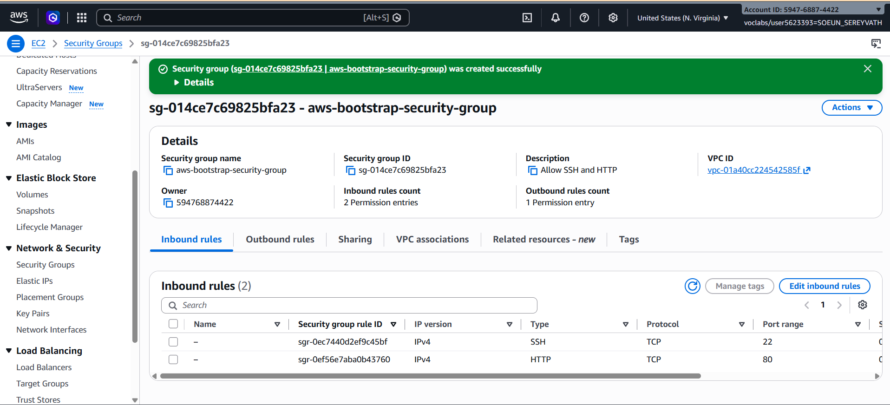
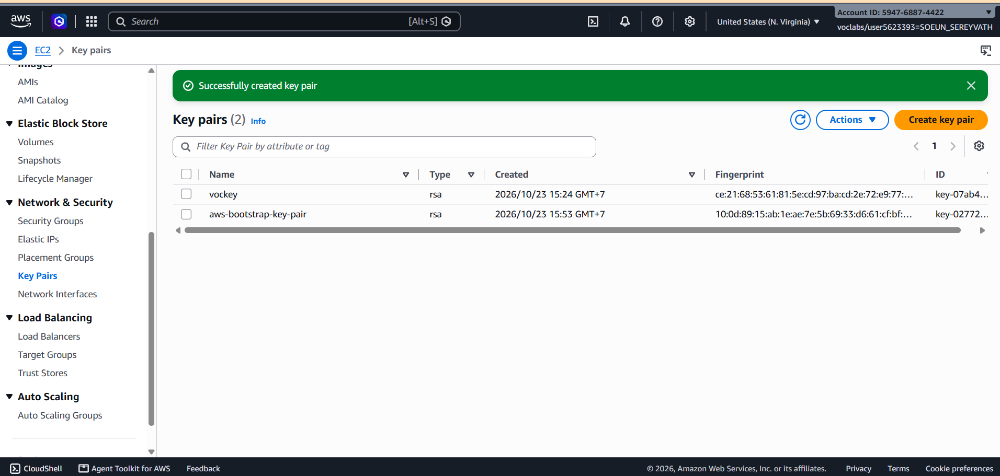
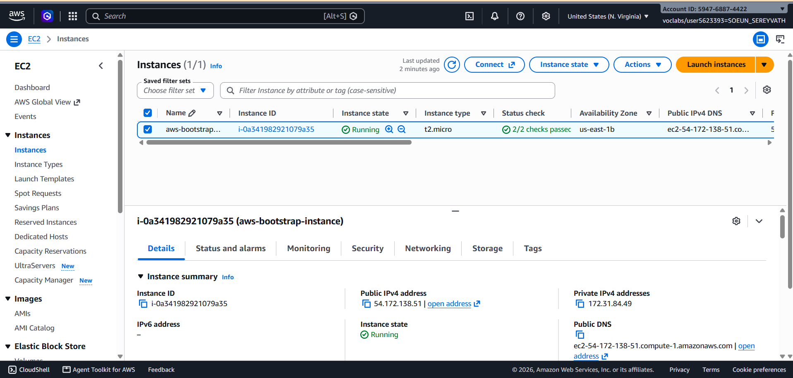
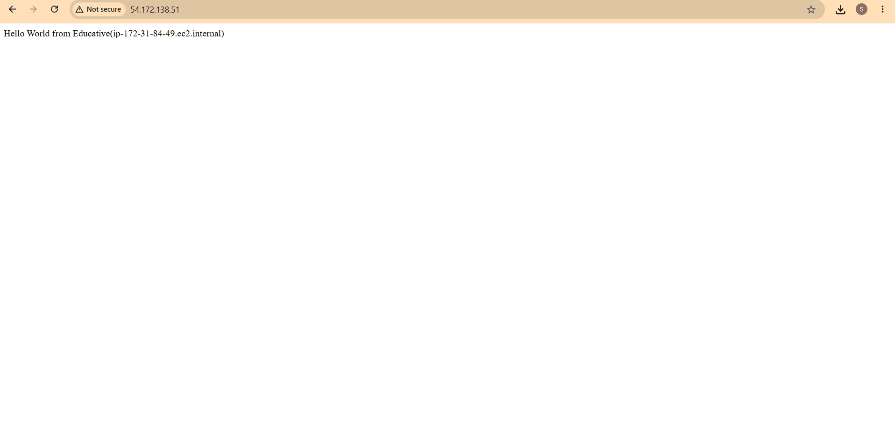
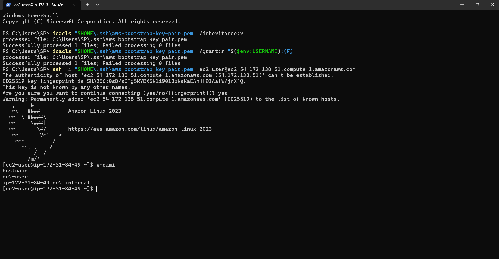
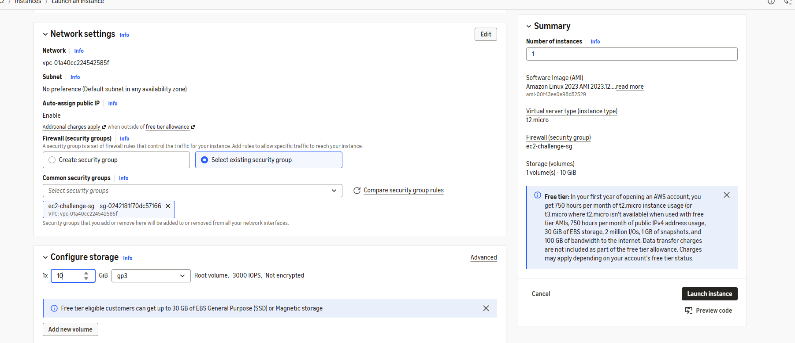
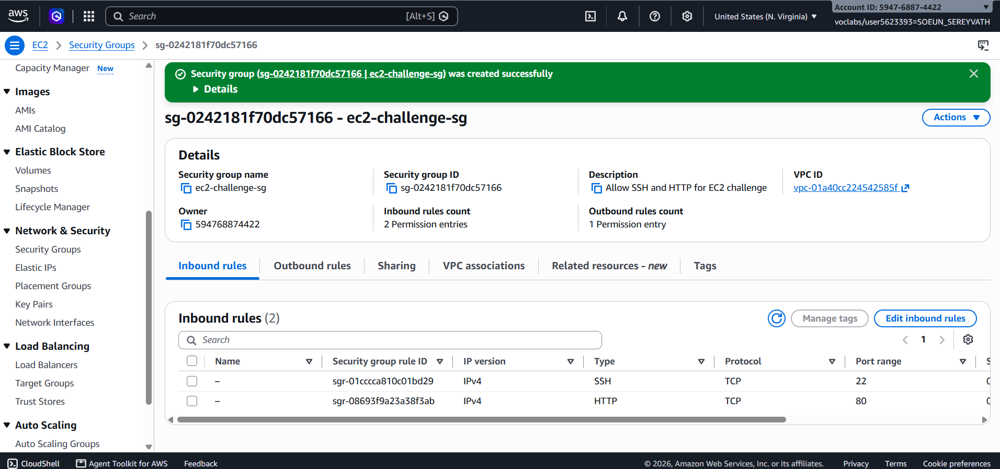
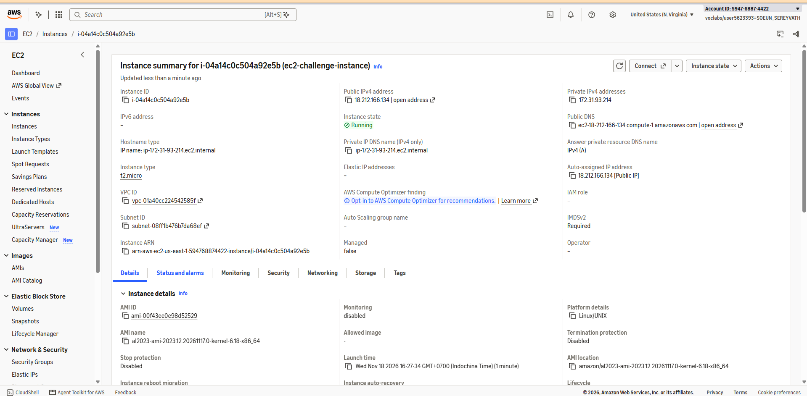
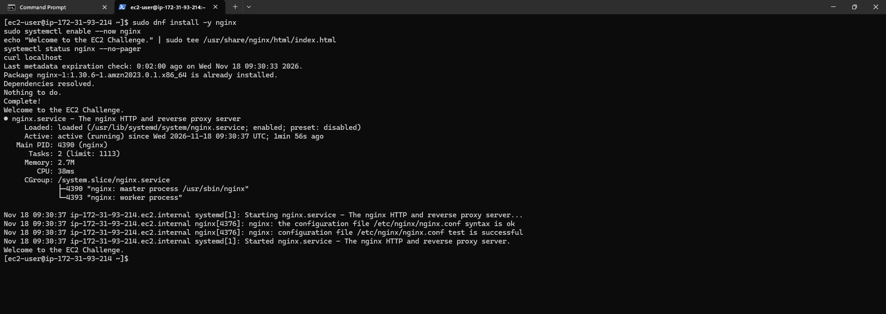
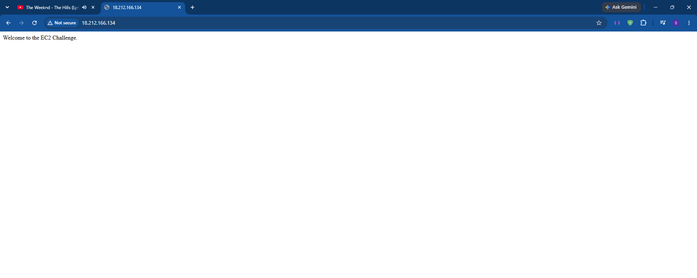

# Cloud Lab 1 Submission — Amazon EC2

- **Student name:** SOEUN SEREYVATH
- **Student ID:** e20220907
- **Learner Lab user name:** voclabs/user5623393=SOEUN_SEREYVATH
- **Date completed:** 2026-11-18

---

## Part 1.1 — An Amazon EC2 Walkthrough

### Security group



### Key pair



### Instance details



### Browser test



### SSH connection



Did you connect with your own SSH client or with EC2 Instance Connect?

I connected with my own SSH client: the OpenSSH `ssh` command in Windows PowerShell. First I locked the key file's permissions with `icacls`, then connected with `ssh -i "$HOME\.ssh\aws-bootstrap-key-pair.pem" ec2-user@<public DNS>`.

---

## Part 1.2 — EC2 Web Solution (Challenge)

Setup:

| Setting | Value |
|---|---|
| Instance name | `ec2-challenge-instance` |
| AMI | Amazon Linux 2023 (64-bit x86) |
| Instance type | `t2.micro` |
| Key pair | `ec2-challenge-key` (RSA, `.pem`) |
| Security group | `ec2-challenge-sg`: inbound SSH (TCP 22) and HTTP (TCP 80) from `0.0.0.0/0` |
| Root volume | 10 GiB gp3 |
| Public IP | Auto-assigned (`18.212.166.134`) |
| Web server | Nginx |

### Launch configuration



### Security group



### Running instance



### Commands on the instance



Paste the commands you ran to install the web server and create `index.html`:

```bash
# From my computer (PowerShell): connect to the instance
ssh -i "$env:USERPROFILE\.ssh\ec2-challenge-key.pem" ec2-user@18.212.166.134

# On the instance: install Nginx, start it now and at every boot
sudo dnf install -y nginx
sudo systemctl enable --now nginx

# Create the web page
echo "Welcome to the EC2 Challenge." | sudo tee /usr/share/nginx/html/index.html

# Check that it works
systemctl status nginx --no-pager
curl localhost
```

### Browser test



---

## Questions

**1. Your security group has an SSH rule and an HTTP rule. What does each one let you do? What would stop working if you deleted the HTTP rule?**

The **SSH rule** (TCP port 22) allows remote log-in to the instance with my private key, so I can run commands on it. I used it to install Nginx and create the web page. The **HTTP rule** (TCP port 80) lets anyone's browser reach the web server on the instance.

If I deleted the HTTP rule, the page at `http://<public IP>` would stop loading: the browser would wait and then time out, because the security group drops the traffic. Nginx would still be running, SSH would still work, and `curl localhost` on the instance would still return the page. Only outside web access would break.

**2. In Part 1.1 you never logged in to install the web server. What installed it, and when did it run?**

The **user data** script I pasted under *Advanced details* installed it. cloud-init runs that script automatically **once, as root, on the instance's first boot** during launch. It ran `yum update`, installed `httpd`, started and enabled it, and wrote `index.html`. That's why the lab says to wait a minute or two after the state becomes *Running*: the script is still running in the background.

**3. Why does the web page open with `http://` but not with `https://`?**

HTTPS uses TCP port **443**, and nothing on the instance handles it. The security group only allows ports 22 and 80, so traffic to 443 is blocked. The web server also only listens on port 80, with no TLS certificate set up. To make HTTPS work, I would need to open port 443 in the security group and give the server a certificate (for example from Let's Encrypt with a domain name).

**4. Part 1.2 asked for a 10 GiB root volume. Where in the launch settings did you set it, and how can you check the size on the running instance?**

I set it in the **Configure storage** section of the *Launch an instance* page, by changing the root volume from the default `8` to `10` GiB (gp3). The Summary panel then showed *1 volume(s) - 10 GiB* (screenshot 06).

To check it on the running instance:
- In the console: select the instance, open the **Storage** tab, and look at the root volume's size, or open it under *Elastic Block Store → Volumes*.
- On the instance over SSH: `lsblk` shows the disk (`xvda`) as `10G`, and `df -h /` shows the size of the root file system.

## Problems and how I solved them (optional)

- **The `.pem` key wasn't in `C:\Users\SP\Downloads`.** My browser saves downloads to `E:\Downloads`, so the `Move-Item` command failed at first. I found the real Downloads folder location in Windows and moved the key from there into `C:\Users\SP\.ssh\`.
- **`Unit nginx.service could not be found`.** I pasted all the commands at once, so `systemctl` ran before `dnf install` had finished. After the install finished, I ran `sudo systemctl enable --now nginx` again, and `systemctl status` showed *active (running)*.

## Clean up

- [x] Part 1.1: instance terminated, key pair and security group deleted.
- [x] Part 1.2: instance terminated, security group (and key pair, if any) deleted.
