# Cloud Lab 2 Submission — Load Balancer and Auto Scaling

- **Student name:** SOEUN SEREYVATH
- **Student ID:** e20220907
- **Learner Lab user name:** voclabs/user5623393=SOEUN_SEREYVATH
- **Date completed:** 2026-11-18

---

## Security groups

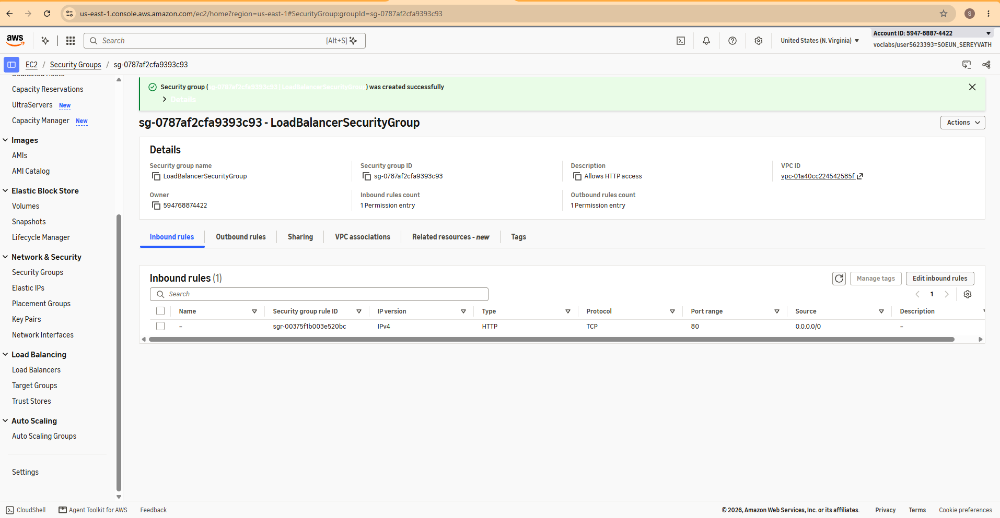

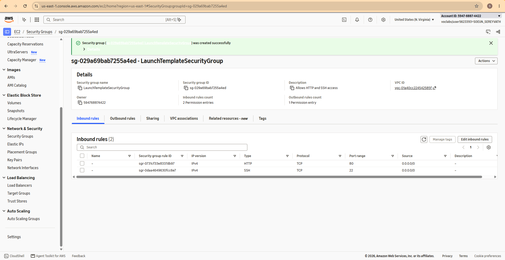

## Target group

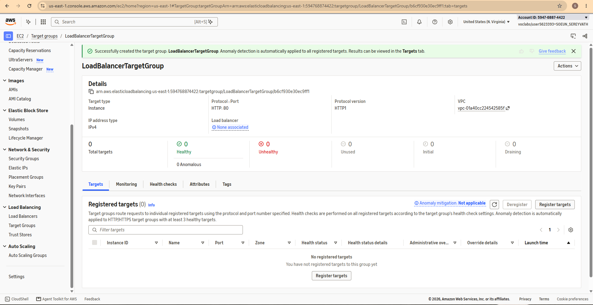

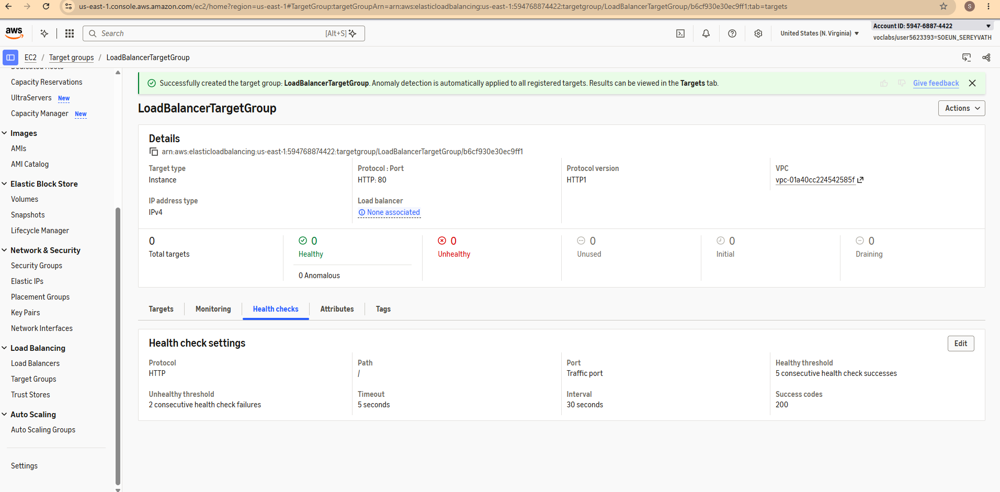

## Application Load Balancer

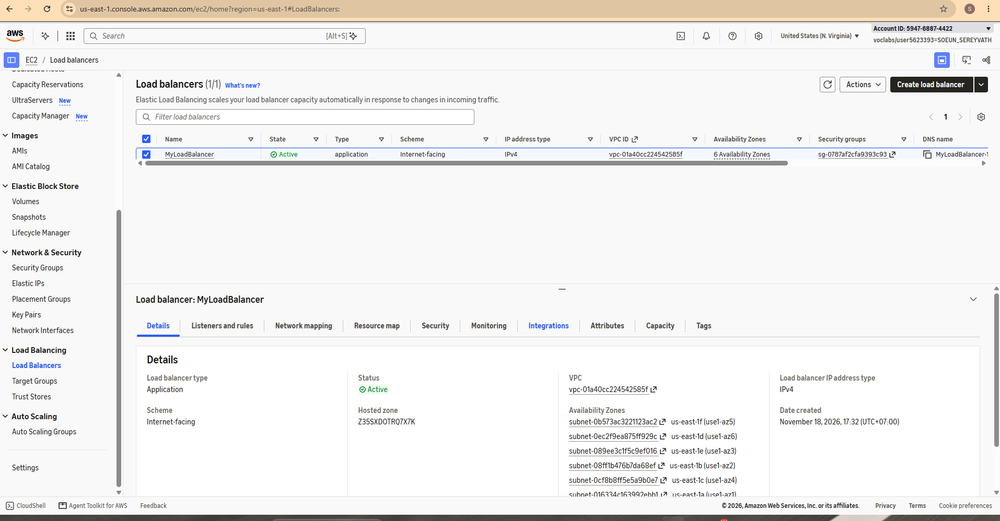

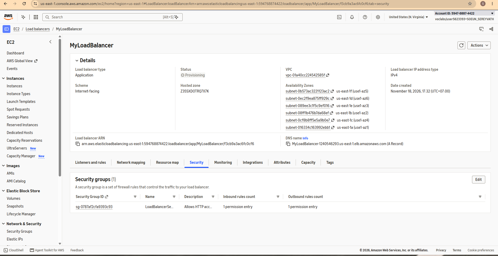

## Launch template

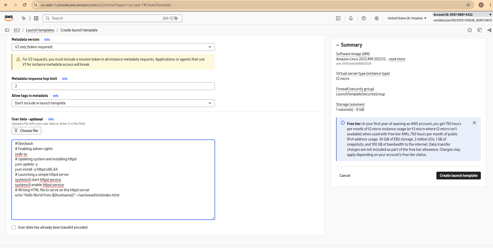

## Auto Scaling group

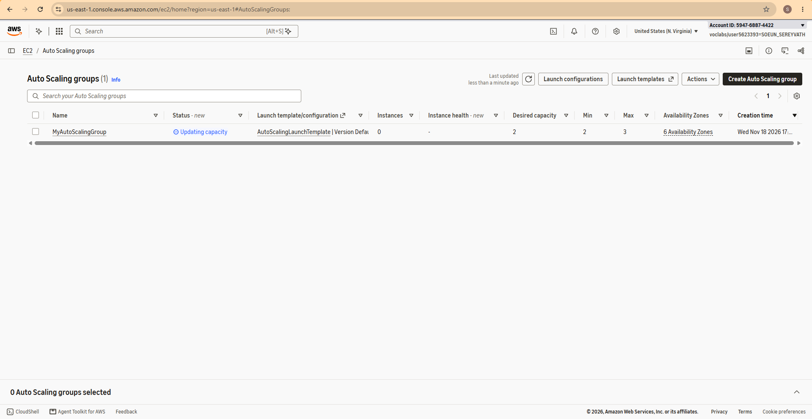

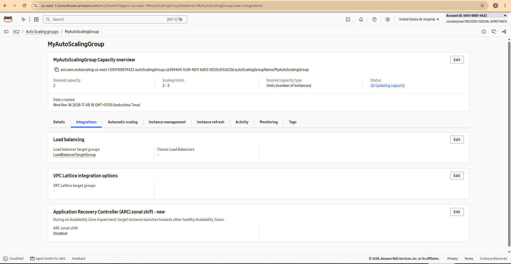

## Load balancing test

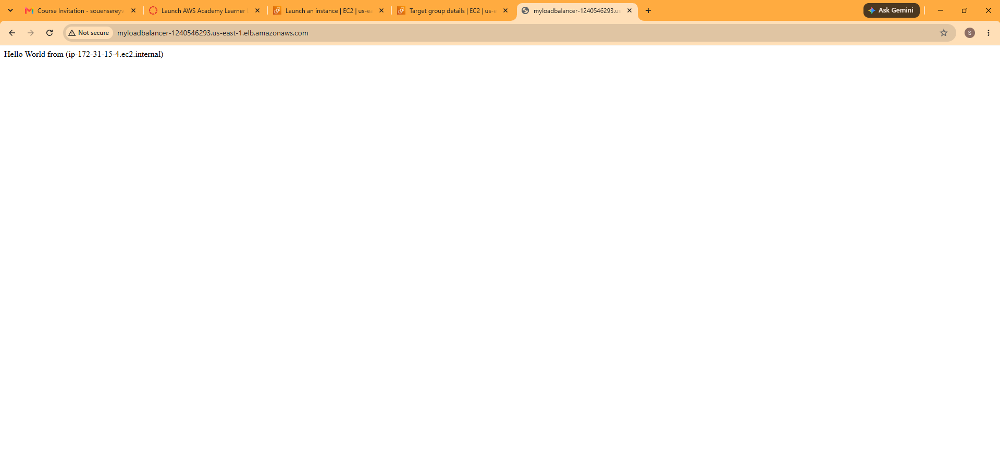

## Simulated application failure

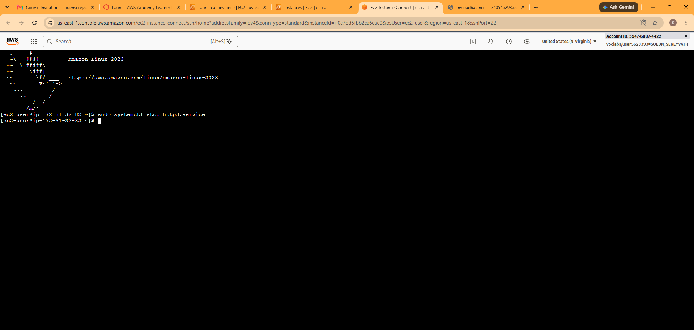

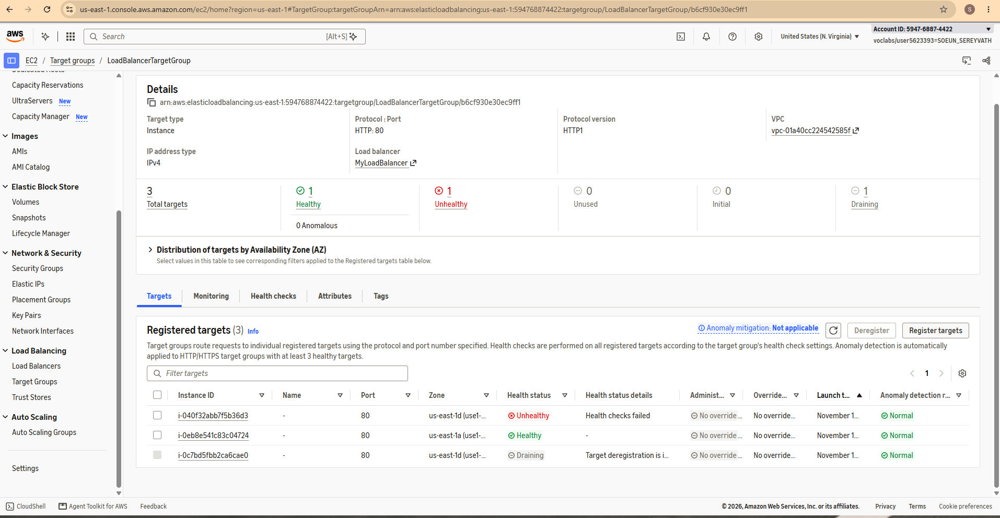

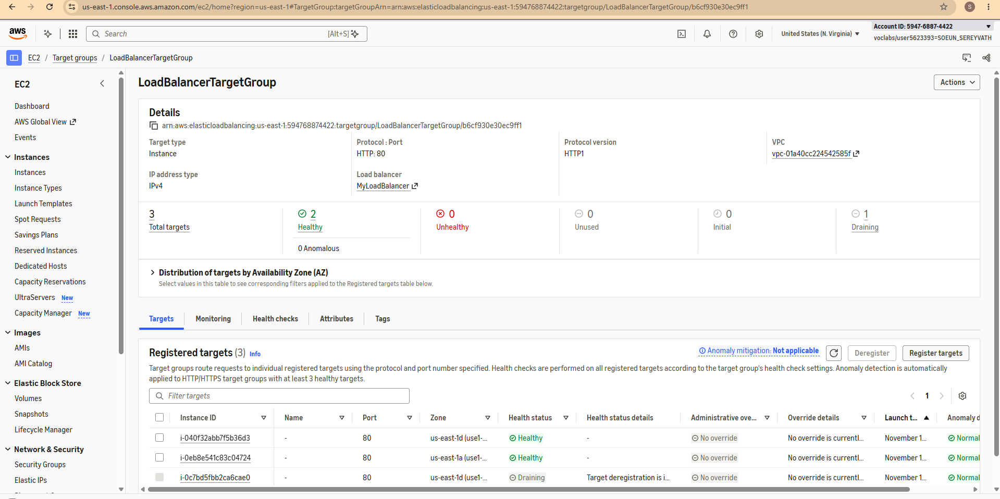

About how many minutes passed between stopping `httpd` and the new instance becoming healthy?

**About 6 minutes.** I stopped `httpd` on `i-0c7bd5fbb2ca6cae0` at 17:59. By 18:01 that instance was *Draining*, and the Auto Scaling group had already launched a replacement (`i-040f32abb7f5b36d3`). The new instance became *Healthy* at about 18:05, after it booted, ran the user data script and passed the health checks.

---

## Questions

**1. Why does the page show a different host name when you refresh it?**

Each instance writes its own host name into `index.html` when its user data script runs. The load balancer spreads requests across all *healthy* targets in `LoadBalancerTargetGroup` (round robin by default), so one request may be answered by `ip-172-31-32-82` and the next by `ip-172-31-15-4`. The page shows which instance actually answered.

**2. After you stopped `httpd`, the instance was still *running* in EC2, but the target group marked it *unhealthy*. What did the health check test, and why did the instance fail it?**

The target group's health check sends an **HTTP request to path `/` on port 80** every **30 seconds** and expects status code **200**. With `httpd` stopped, nothing was listening on port 80, so the requests failed. After **2 failures in a row** (the unhealthy threshold), the target group marked the instance *unhealthy*.

EC2 still showed it as *running* (2/2 status checks) because EC2 status checks only test the virtual machine and the operating system, not the application running on it. The load balancer's health check tests the application.

**3. Who replaced the failed instance: the load balancer, the target group, or the Auto Scaling group? Explain the role of each one.**

The **Auto Scaling group** replaced it.

- **Load balancer:** the single entry point for clients. It receives HTTP requests on its listener (port 80) and forwards each one to a healthy target.
- **Target group:** the list of targets behind the load balancer. It runs the health checks, marks failing targets *unhealthy*, and stops sending traffic to them (*draining*). It does not create or delete instances.
- **Auto Scaling group:** keeps the number of instances at the desired capacity. Because *Elastic Load Balancing health checks* are turned on, it treats a target that the load balancer reports as unhealthy as a failed instance. It terminated that instance and launched a new one from `AutoScalingLaunchTemplate`, then registered the new instance in the target group automatically.

**4. With desired 2, minimum 2 and maximum 3, how many instances run normally? In what situation could there be 3?**

Normally **2** instances run, which is the desired capacity. There could be **3** if the desired capacity goes up to 3: for example, a scaling policy (such as target tracking on CPU usage) adds an instance under heavy load, or someone raises the desired capacity by hand or with a scheduled action. It can never go above the maximum of 3.

There can also briefly be 3 during a replacement, as in screenshot 13: the old instance was still *draining* while the new one was already starting.

**5. The instances' security group allows HTTP from anywhere. How could you change it so that the instances accept HTTP only from the load balancer?**

Edit the inbound HTTP rule of `LaunchTemplateSecurityGroup`: change its source from `0.0.0.0/0` (Anywhere-IPv4) to the **security group of the load balancer**, `LoadBalancerSecurityGroup` (`sg-0787af2cfa9393c93`). Then only traffic coming from the load balancer's network interfaces reaches port 80 on the instances, and direct requests to an instance's public IP are blocked. In the same way, the SSH rule could be limited to my own IP address instead of anywhere.

## Problems and how I solved them (optional)

- **Refreshing showed the same host name every time.** The browser was showing a cached copy of the page instead of sending a new request. A hard refresh (**Ctrl+Shift+R**) made it load from the load balancer again, and the second host name appeared. Testing with `curl` several times also showed both host names.
- **The new instance was *Unhealthy* at first.** Right after the Auto Scaling group launched the replacement, it was still running the user data script (`yum update` and installing `httpd`), so its first health checks failed. After a few minutes `httpd` was running and it turned *Healthy*.

## Clean up

- [x] `MyAutoScalingGroup` deleted and its instances terminated.
- [x] `AutoScalingLaunchTemplate` deleted.
- [x] `MyLoadBalancer` and `LoadBalancerTargetGroup` deleted.
- [x] Both security groups deleted.
