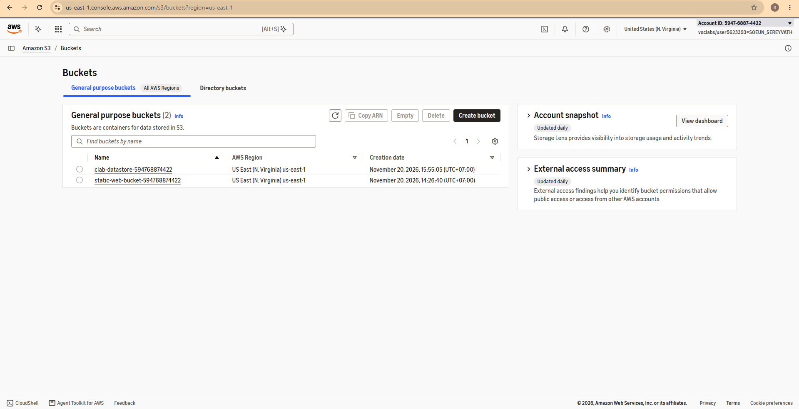
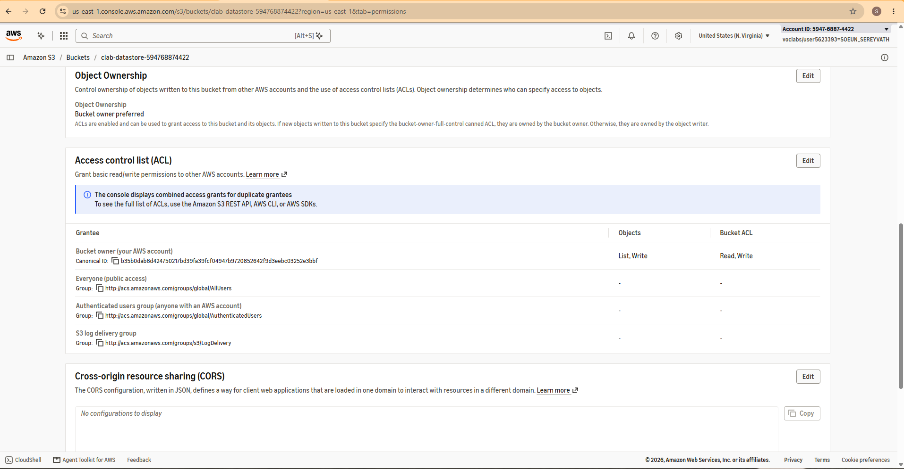
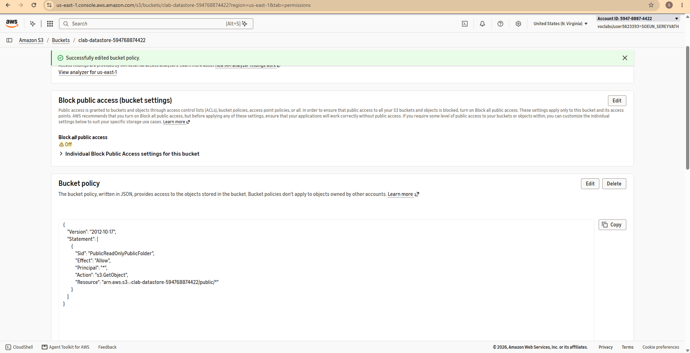
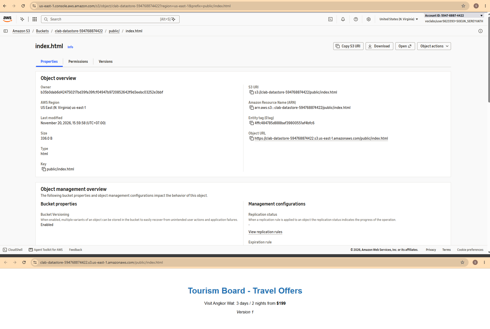
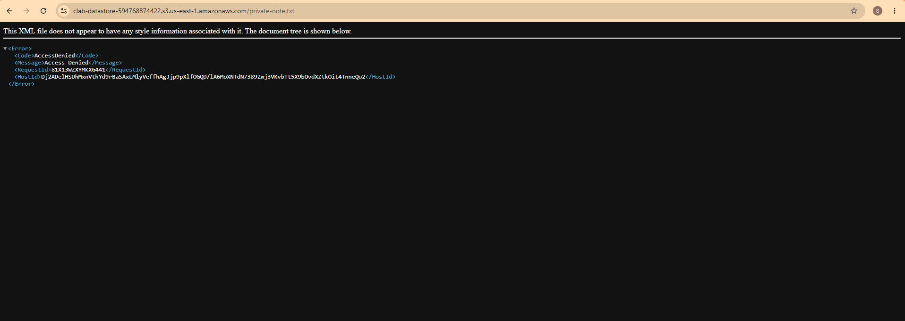
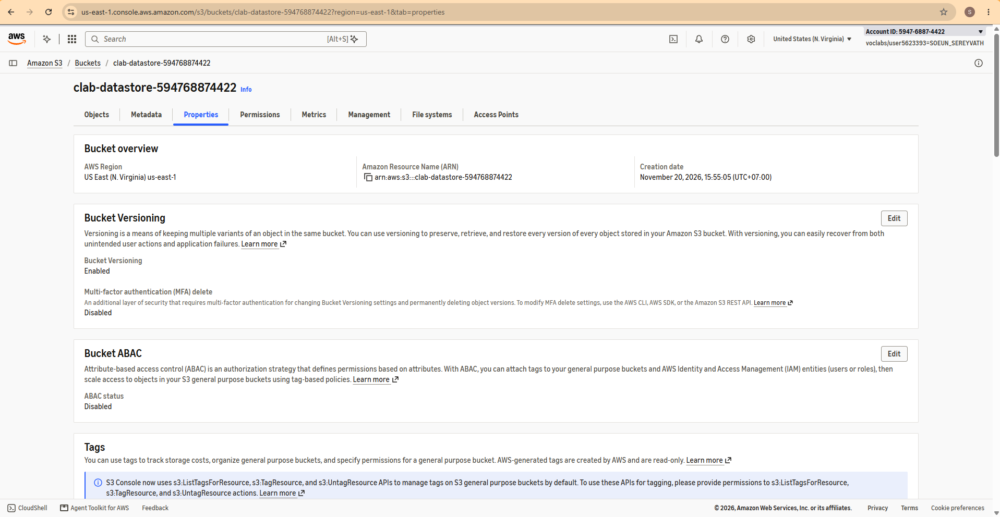
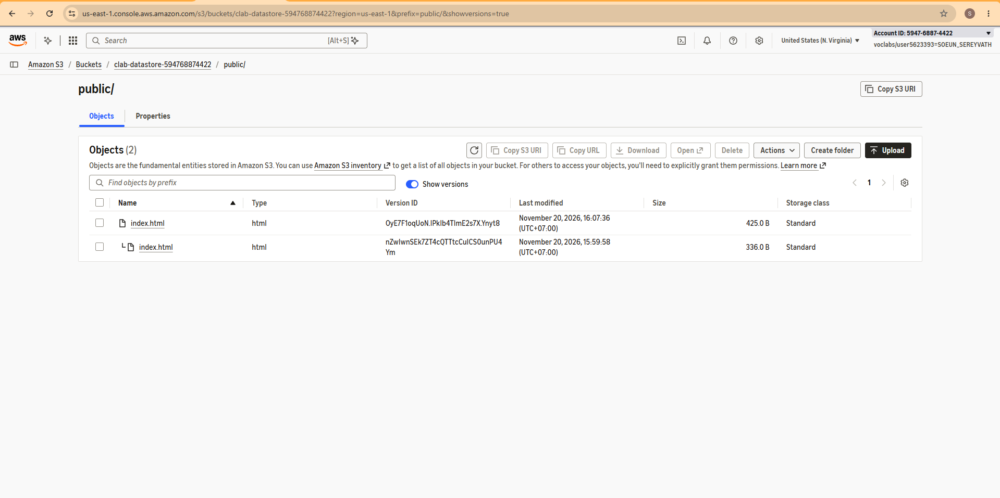
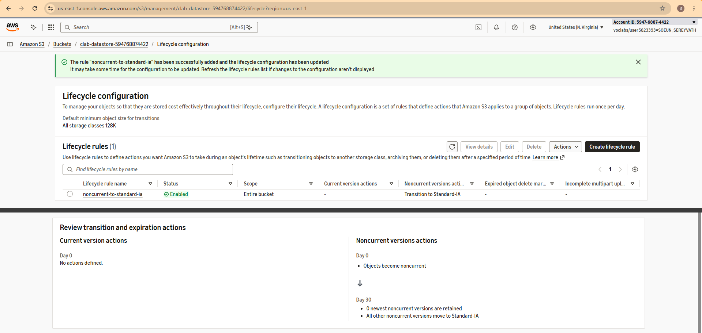

# Cloud Lab 3 Challenge Submission — Secure S3 Bucket

- **Student name:** SOEUN SEREYVATH
- **Student ID:** e20220907
- **Learner Lab user name:** voclabs/user5623393=SOEUN_SEREYVATH
- **Bucket name:** `clab-datastore-594768874422`
- **Date completed:** 2026-11-20

---

## 1. Bucket



## 2. Object ownership



## 3. Public access policy







My policy is in [bucket-policy.json](bucket-policy.json). Explain which line limits public access to the `public/` folder:

```json
"Resource": "arn:aws:s3:::clab-datastore-594768874422/public/*"
```

The `Resource` line limits public access. The statement allows `s3:GetObject` for everyone (`"Principal": "*"`), but **only** on object keys that start with `public/`. Any other object, like `private-note.txt` at the bucket root, doesn't match this ARN. No other statement allows public access, so S3 denies those requests by default. I tested it:

| Object URL | Result |
|---|---|
| `https://clab-datastore-594768874422.s3.us-east-1.amazonaws.com/public/index.html` | **200**, the page loads |
| `https://clab-datastore-594768874422.s3.us-east-1.amazonaws.com/private-note.txt` | **403 AccessDenied** |

The policy also allows only `s3:GetObject` (read). The public can't list the bucket, upload, or delete anything.

## 4. Versioning



My test: after versioning was on, I uploaded a second version of `public/index.html`. The object now has two versions:



## 5. Lifecycle rule



Rule `noncurrent-to-standard-ia`: scope **entire bucket**, action **transition noncurrent versions** to **S3 Standard-IA** **30 days** after they become noncurrent.

---

## Questions

**1. You turned off parts of Block Public Access for this bucket. Why was that needed, and why is it still safe for the objects outside `public/`?**

Block Public Access is on by default and **overrides** everything else. With *"Block public access to buckets and objects granted through new/any public bucket or access point policies"* turned on, S3 refuses to save or apply a bucket policy that grants access to `"Principal": "*"`. So I had to turn off **those two policy-related settings** to use a public-read policy for `public/`. I kept the two **ACL-related** settings turned on, because I don't use ACLs to make anything public.

It's still safe for everything outside `public/` because turning off Block Public Access only **stops S3 from blocking** public permissions. It doesn't make anything public by itself. Objects are still private unless a policy allows access. My only `Allow` statement covers `…/public/*` and only the read action `s3:GetObject`, so every other key, like `private-note.txt` at the root, returns **403 AccessDenied**. The bucket owner is also set to own every object (*Bucket owner preferred*), so this one bucket policy controls access to all of them.

**2. What is a noncurrent version? Give an example from your own test.**

With versioning on, S3 keeps every version of an object. The newest version is the **current** one, and it's what you get when you request the object without a version ID. When a new version is uploaded (or the object is deleted), the previous version becomes **noncurrent**. It's still stored and can be restored, but it's no longer what's served by default.

In my test, I uploaded `public/index.html` (version 1: *"Angkor Wat from $199"*, 336 B) at 15:59:58. After versioning was on, I uploaded an updated `public/index.html` (version 2: *"$179 (new price!)"* plus a new offer, 425 B) at 16:07:36. With **Show versions** on, the object has two versions:

| Version ID | Last modified | Size | State |
|---|---|---|---|
| `0yE7F1oqUoN.IPklb4TlmE2s7X.Ynyt8` | 16:07:36 | 425 B | **current** (version 2) |
| `nZwlwnSEk7ZT4cQTTcCulCS0unPU4Ym` | 15:59:58 | 336 B | **noncurrent** (version 1) |

The public URL serves version 2, while version 1 is kept as a noncurrent version.

**3. Why move noncurrent versions to S3 Standard-IA instead of deleting them?**

Old versions are rarely read, but the content team wants to **keep** them so they can track changes and roll back a page that was overwritten or deleted by mistake. Deleting them would lose that history. **S3 Standard-IA** (Infrequent Access) costs less per GB stored than S3 Standard, with the same durability and millisecond access. The trade-off is a small fee per GB retrieved, and a minimum storage time and object size. That fits old versions well: they cost less to keep, and they're still available right away when someone needs to restore one.

## Clean up

- [x] All object versions deleted and the bucket deleted.
