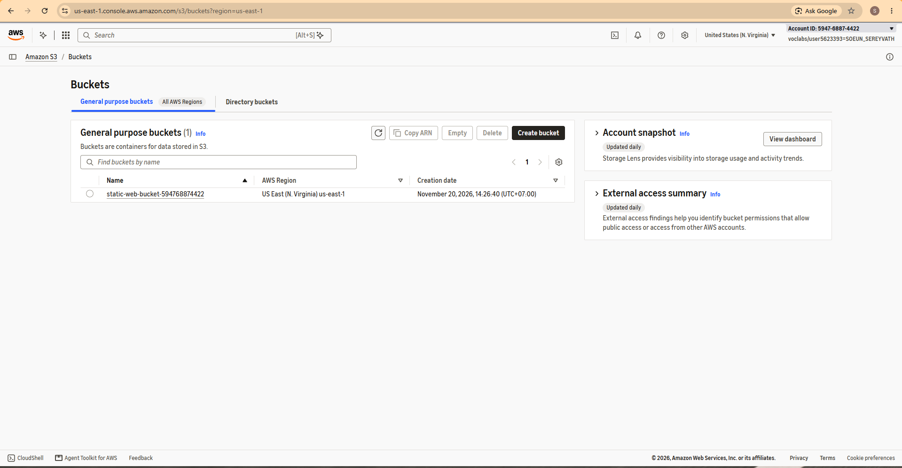
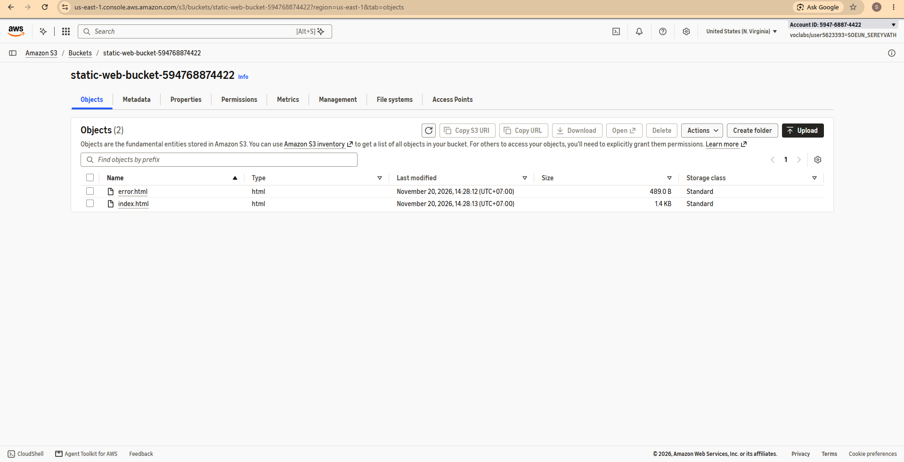
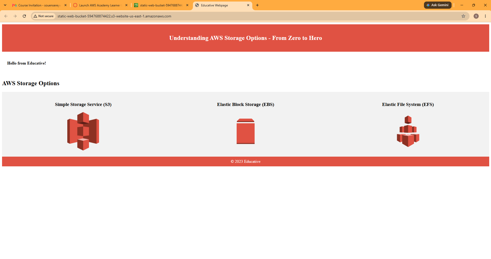
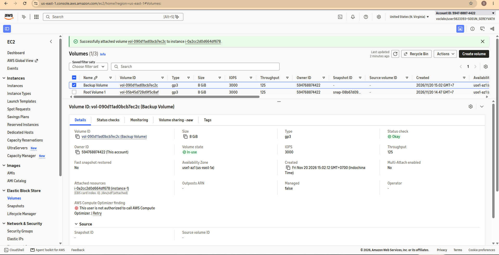
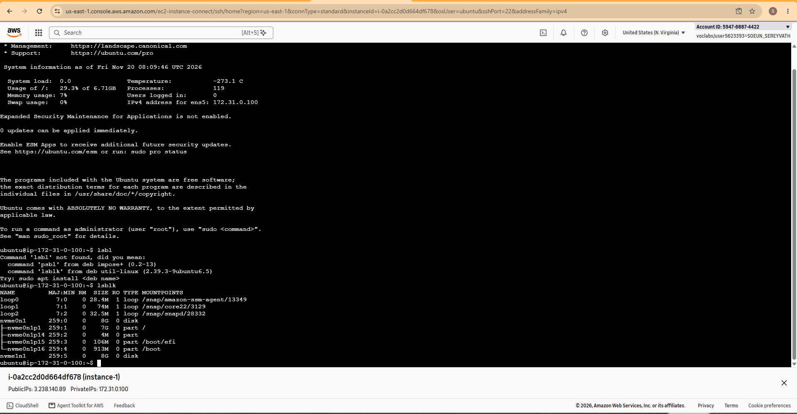
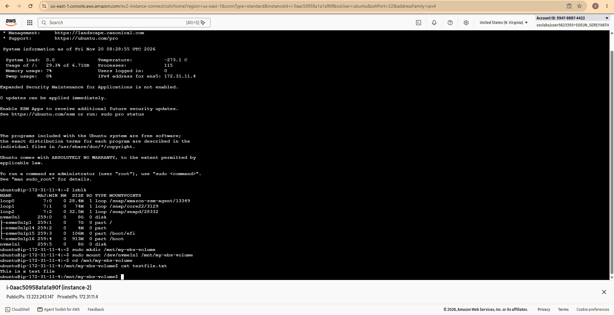
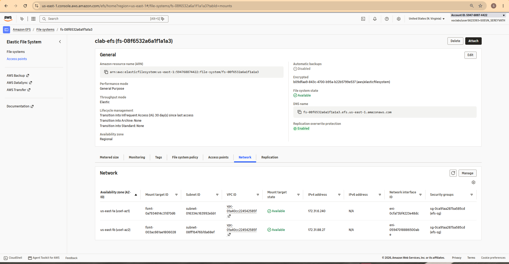
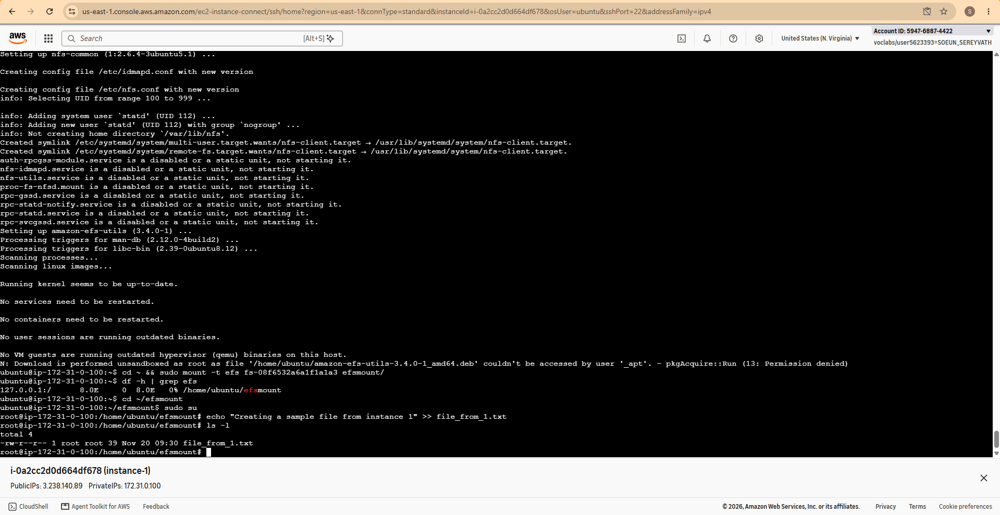
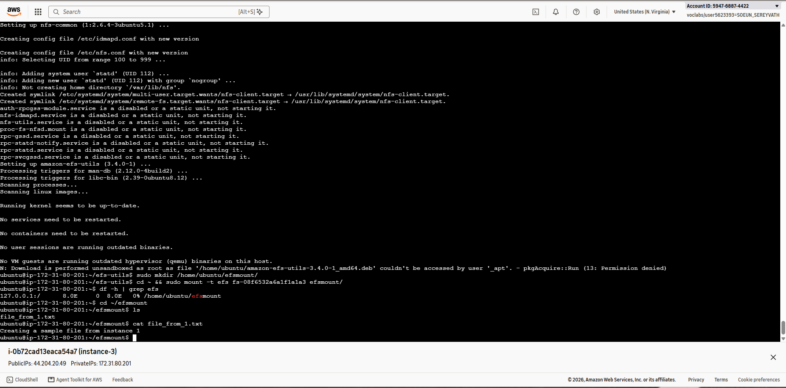

# Cloud Lab 3 Submission — AWS Storage Options

- **Student name:** SOEUN SEREYVATH
- **Student ID:** e20220907
- **Learner Lab user name:** voclabs/user5623393=SOEUN_SEREYVATH
- **Date completed:** 2026-11-20

---

## Part 2.1 — Amazon S3

### Bucket list

### Uploaded files

### Static website

---

## Part 2.2 — Amazon EBS

### Volumes page

### Attached volume (`lsblk`)

Which device name did your volume get (`xvdf`, `nvme1n1`, ...)?

**`nvme1n1`.** I attached the volume as `/dev/sdf`, but the instances are `t3.medium` (Nitro), so EBS volumes show up as NVMe devices. The root volume is `nvme0n1` with its partitions, and **Backup Volume** is the 8 GiB `nvme1n1` disk with no partitions and no mount point. It had the same name on `instance-2`.

### File read on instance-2

---

## Part 2.3 — Amazon EFS

### File system and mount targets

### File created on instance-1

### File listed on instance-3

---

## Questions

**1. After you turned on static website hosting, the endpoint first answered 403 Forbidden. Why, and what changed after you added the bucket policy?**

Turning off *Block Public Access* only **stops S3 from blocking** public permissions. It doesn't **give** anyone permission. At that point no policy allowed anonymous users to read objects, so S3 denied every request with `403 AccessDenied`, even for `error.html`. The page showed *"An Error Occurred While Attempting to Retrieve a Custom Error Document"*.

The bucket policy added an `Allow` statement for `Principal: "*"` (everyone) on the action `s3:GetObject` for `arn:aws:s3:::static-web-bucket-594768874422/*` (every object in the bucket). After that, anonymous browsers could read `index.html`, and the website endpoint returned the page (HTTP 200).

**2. `testfile.txt` was still there after you moved Backup Volume to `instance-2`. What would have happened to a file saved on `instance-1`'s root volume after terminating `instance-1`?**

It would have been **lost**. The root volume is created with the instance and has *Delete on termination* turned on by default, so terminating `instance-1` also deletes **Root Volume 1** and everything on it. **Backup Volume** is an additional volume that exists independently of any instance, so its data survives the instance. That's why I could detach it, attach it to `instance-2`, and still read `testfile.txt`.

**3. Why did you run `mkfs` on `instance-1` but not on `instance-2`?**

A new EBS volume is raw, unformatted block storage, so on `instance-1` I had to create an `ext4` file system on it with `mkfs` before I could mount it and write files. On `instance-2` the volume **already had** that file system and `testfile.txt` on it. Running `mkfs` again would have created a new, empty file system and **erased** the file. So on `instance-2` I only created the mount point and mounted it.

**4. Why could `instance-1` and `instance-3` use the EFS file system at the same time, when an EBS volume had to be detached first? Why did they have to be in the subnets of the mount targets?**

EFS is a **network file system** (NFS). Many clients can mount it at the same time over the network, and EFS handles file locking and consistency, so a file written on `instance-1` was immediately visible on `instance-3`. A standard EBS volume is a **block device** attached to one instance, like a hard disk. Two machines writing to the same block device with a normal file system like `ext4` would corrupt it, so I had to unmount and detach it from `instance-1` before attaching it to `instance-2`.

An instance reaches EFS through a **mount target**, which is a network interface with an IP address inside a subnet in one Availability Zone. Each instance connects through the mount target in its own Availability Zone. I only created mount targets in `us-east-1a` and `us-east-1b`, so the instances had to be in those zones: `instance-1` in 1a and `instance-3` in 1b. The mount target's security group (`efs-sg`) also had to allow NFS (TCP 2049).

**5. For each need, choose S3, EBS or EFS and give one reason: (a) a website's images, (b) the disk of a database server, (c) a folder shared by several web servers.**

| Need | Choice | Reason |
|---|---|---|
| (a) A website's images | **S3** | Object storage that is cheap, scales without limit, and can serve files directly over HTTP (or through CloudFront) to any number of visitors. |
| (b) The disk of a database server | **EBS** | Block storage attached to one instance with low latency and consistent IOPS, which a database needs for its data files. |
| (c) A folder shared by several web servers | **EFS** | A shared NFS file system that many instances, in several Availability Zones, can mount and read and write at the same time. |

## Problems and how I solved them (optional)

- **The console's defaults weren't what the lab asked for.** It picked Ubuntu 26.04 and `t3.micro`. I changed them to **Ubuntu Server 24.04 LTS** and **`t3.medium`**. Changing the AMI also reset the security group, so I selected `ec2instances-sg` again. When I used *Launch more like this* for `instance-2` and `instance-3`, the *Proceed without a key pair* choice was dropped, so I selected it again.
- **EC2 Instance Connect failed** with *"Error establishing SSH connection"*. The connect shortcut used the user `ec2-user`, which only exists on Amazon Linux. On Ubuntu the user is **`ubuntu`**. After I changed the username, the connection worked.
- **The device was `nvme1n1`, not `xvdf`.** On `t3` instances, EBS volumes appear as NVMe devices, so I used `/dev/nvme1n1` in the `mkfs` and `mount` commands.
- **Commands got lost when I pasted several lines at once.** After `sudo su` started a new shell, the remaining lines weren't run, so `testfile.txt` wasn't created at first. I ran the commands one at a time instead, using `mkdir -p` and `mountpoint -q … || mount …` so they were safe to re-run, and **didn't** run `mkfs` a second time.
- **`No space left on device` when installing `amazon-efs-utils`.** Building it from source (Rust toolchain plus Cargo build files) filled the 8 GiB root volume, so `dpkg` couldn't unpack the package. The build itself had finished, so I copied the `.deb` to my home folder, deleted the build leftovers (`~/efs-utils/src/target`, `~/.rustup`, `~/.cargo`), ran `apt-get clean`, repaired the failed install with `apt-get -f install`, and installed the `.deb` again. After that, `mount -t efs` worked on both instances.

## Clean up

- [x] Instances `instance-1`, `instance-2`, `instance-3` terminated.
- [x] `clab-efs` and **Backup Volume** deleted.
- [x] Security groups `efs-sg` and `ec2instances-sg` deleted.
- [x] S3 bucket emptied and deleted.
